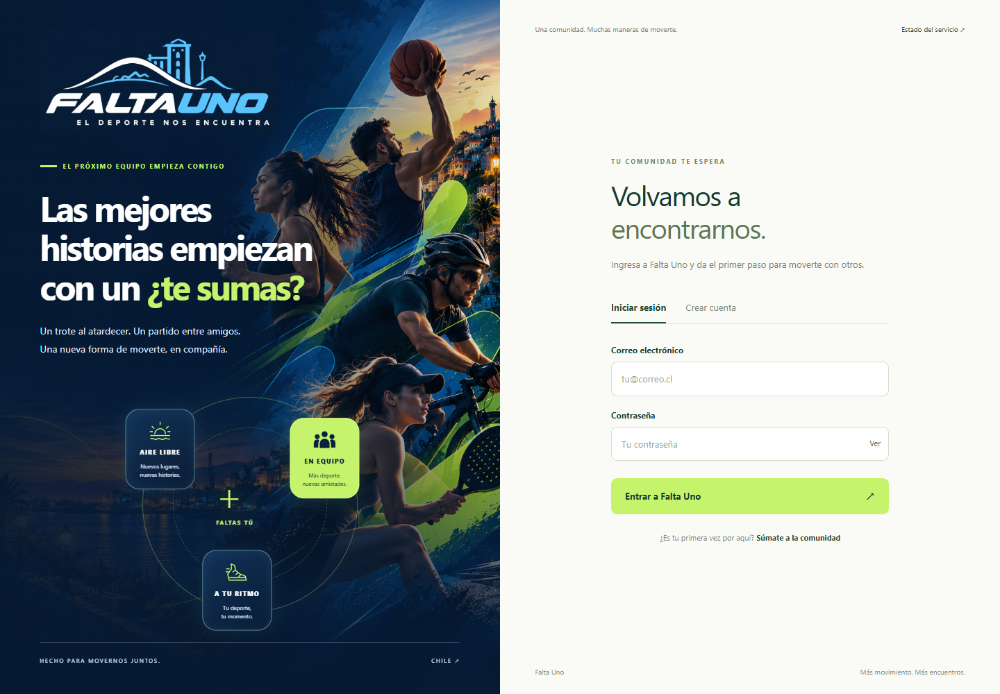
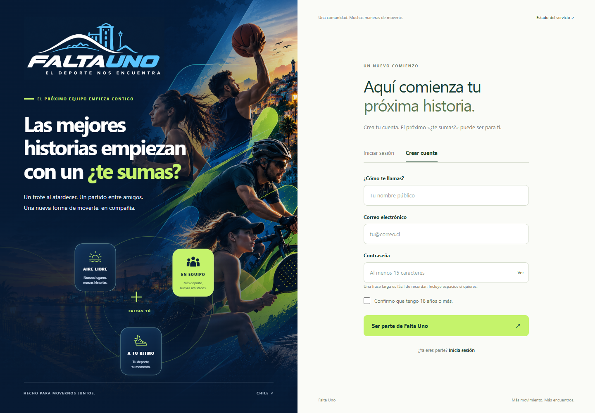

# Segunda fase: Falta Uno, aplicaciones y autenticación

Fecha de verificación: 25 de octubre de 2026.

Esta entrega sustituye el prototipo anterior por `apps/frontend` (Angular 22,
Signals y Tailwind) y `apps/backend` (NestJS 12, ESM y Prisma). Permite crear
una cuenta, iniciar sesión, recuperar la sesión vigente y cerrarla contra
PostgreSQL real. El nombre visible es **Falta Uno**.

## Cambios

- Retiro del frontend antiguo y del gitlink vacío `falta-uno-api`.
- Organización de aplicaciones y reserva de `libs/shared-contracts`.
- Compilación del paquete `@comunidad/database` para su consumo desde NestJS.
- Configuración validada y credenciales locales con usuario limitado.
- Diagnóstico `/health` que ejecuta SQL real, más pantalla `/estado`.
- API de registro, login, sesión y logout; contraseñas scrypt y sesiones
  revocables con cookie HttpOnly y token almacenado como hash.
- Validación de entradas, control de orígenes, rechazo de campos adicionales
  y límite de intentos local al proceso.
- Formularios con errores, espera, mostrar contraseña y confirmación de mayoría de edad.
- Identidad visual azul marino, fondo multideportivo y logo azul basado en la referencia.
- Documentación de instalación, alcance de autenticación y recursos visuales.
- Script opcional para renombrar la carpeta local y reparar su junction de
  dependencias. El nombre de una carpeta clonada no se cambia desde GitHub;
  el renombrado local sigue pendiente mientras Windows la mantenga en uso.

No hay nuevas tablas ni modificaciones de la migración SQL `0_init`.
Los nombres técnicos existentes de bases y volúmenes se conservan.

## Validación

| Comprobación | Resultado |
| --- | --- |
| Compilación backend y paquete de base de datos | Aprobada |
| Pruebas unitarias backend | 18 aprobadas |
| Pruebas de integración HTTP y PostgreSQL | 9 aprobadas |
| Compilación frontend | Aprobada |
| Pruebas frontend | 7 aprobadas |
| API local `/health` | HTTP 200, database up |
| Revisión visual | Login y registro con el logo actual; adaptación móvil revisada |

Las pruebas de autenticación descartan sus cuentas y sesiones mediante rollback.

## Capturas actuales

### Inicio de sesión



### Registro



## Reproducir en otro equipo

Con Node.js 24 y Docker Desktop funcionando, desde la raíz:

```powershell
npm.cmd run docker:up
npm.cmd --prefix packages/database ci
npm.cmd --prefix packages/database run backend:env
npm.cmd --prefix apps/backend ci
npm.cmd --prefix apps/frontend ci
```

En dos terminales independientes:

```powershell
npm.cmd --prefix apps/backend run start:dev
```

```powershell
npm.cmd --prefix apps/frontend start
```

Abrir `http://localhost:4200`. Revisar `/registro`, `/iniciar-sesion` y `/estado`.
Si la vista previa usa otro origen, agregarlo a FRONTEND_ORIGINS en el `.env`
local del backend y reiniciar el servidor.

## Pendientes

Verificación por correo, recuperación de contraseña y Google no están
implementados. Las cuentas quedan pendientes de verificación y pueden iniciar
sesión en este flujo inicial. Encuentros deportivos, mapas, Nx, aplicaciones
móviles y despliegue productivo siguen pendientes. El límite de intentos debe
compartirse entre procesos antes de usar varias réplicas.

Consultar [autenticación](auth.md) y [estructura](ESTRUCTURA.md).
Esta fase continúa el PR #1 de base de datos y Docker.
